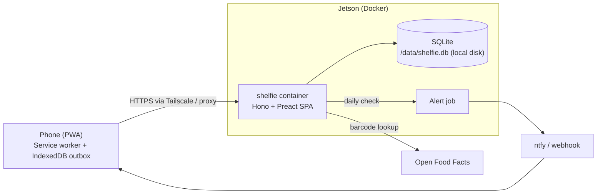
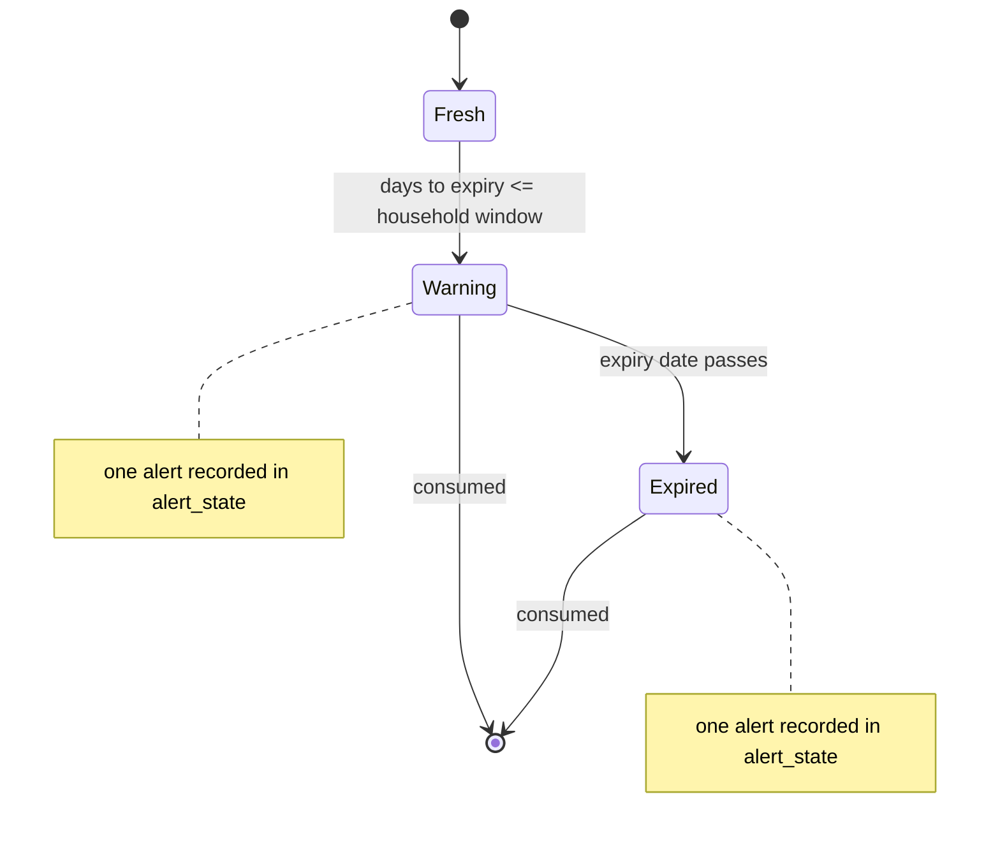

# Architecture diagrams

## Runtime topology



## Offline write and replay

```mermaid
sequenceDiagram
  participant U as User
  participant C as Client (PWA)
  participant O as Outbox (IndexedDB)
  participant S as Server
  U->>C: Scan barcode, set expiry
  C->>O: Append lot.add (client_id)
  C-->>U: Shows lot as pending
  Note over C,S: Network returns, or app opens
  C->>S: POST /api/sync { ops }
  S->>S: Apply each op; resolve barcode via Open Food Facts
  S-->>C: results (applied / duplicate / gone / invalid)
  C->>O: Remove applied and duplicate ops
  C->>S: GET inventory
  C-->>U: Updated list, pending count cleared
```

## Expiry alert lifecycle


